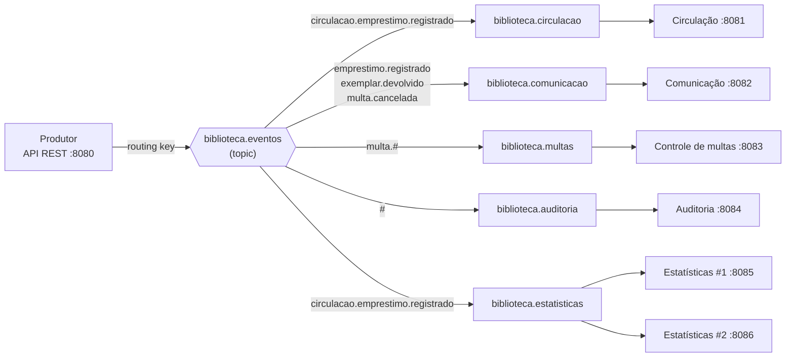

# Biblioteca universitária — mensageria com RabbitMQ (Tema 05)

**Integrantes:** _(preencher: 5 nomes)_
**Stack:** Java 21 · Spring Boot 3.3 · Spring AMQP · RabbitMQ 3.13 · PostgreSQL 16

## 1. Domínio e arquitetura

A aplicação produtora registra fatos da biblioteca e os publica como **eventos** (um fato que ocorreu, não uma ordem).
Cinco responsabilidades de consumo reagem de forma independente. O produtor não conhece nenhum consumidor:
a falha de um consumidor não derruba o fluxo (desacoplamento temporal, sem cascata síncrona).



Cada consumidor é um processo separado (mesma base de código, perfil Spring diferente). Cada um tem sua fila
durável e suas tabelas no PostgreSQL (o "efeito verificável por consulta").

## 2. Contrato JSON do evento

```json
{
  "eventId": "7c1f6a52-3a0e-4c55-9d0f-2a5d4f7e9b10",
  "tipo": "EMPRESTIMO_REGISTRADO",
  "ocorridoEm": "2026-11-18T13:45:10.123Z",
  "dados": { "emprestimoId": "EMP-421", "exemplarId": "EX-5530", "titulo": "Sistemas Distribuidos",
             "categoria": "Computacao", "leitorId": "L-217", "leitorNome": "Ana Souza",
             "dataPrevistaDevolucao": "2026-12-02" }
}
```

| Tipo | Routing key | Campos em `dados` |
|---|---|---|
| EMPRESTIMO_REGISTRADO | `circulacao.emprestimo.registrado` | emprestimoId, exemplarId, titulo, categoria, leitorId, leitorNome, dataPrevistaDevolucao |
| EXEMPLAR_DEVOLVIDO | `circulacao.exemplar.devolvido` | emprestimoId, exemplarId, leitorId, leitorNome, devolvidoEm |
| MULTA_APLICADA | `multa.aplicada` | multaId, emprestimoId, leitorId, valor, motivo |
| MULTA_CANCELADA | `multa.cancelada` | multaId, leitorId, leitorNome, valor, motivo |
| MULTA_PAGA *(extra de demo)* | `multa.paga` | multaId, leitorId, valor |

`eventId` é o identificador único; ao republicar, o mesmo `eventId` é reutilizado.

## 3. Configuração do RabbitMQ

**Exchange:** `biblioteca.eventos`, tipo **topic**, durável. Routing key = `<família>.<fato>`.
Filas e vínculos são declarados em código (`config/Topologia.java`), de forma idempotente, por todos os processos.
Assim as filas existem desde a primeira conexão de qualquer aplicação, mesmo com um consumidor ainda desligado.
Também existe `biblioteca.dlx` (fanout) + `biblioteca.dlq` para mensagens que falham definitivamente.

### Matriz de roteamento (evento × consumidor)

| Evento | Circulação | Comunicação | Multas | Auditoria | Estatísticas |
|---|:-:|:-:|:-:|:-:|:-:|
| Empréstimo registrado | ✅ | ✅ | ❌ | ✅ | ✅ (1 das 2 instâncias) |
| Exemplar devolvido | ❌ | ✅ | ❌ | ✅ | ❌ |
| Multa aplicada | ❌ | ❌ | ✅ | ✅ | ❌ |
| Multa cancelada | ❌ | ✅ | ✅ | ✅ | ❌ |
| *Multa paga (família nova)* | ❌ | ❌ | ✅ | ✅ | ❌ |

### Vínculos (fila ← padrão)

| Fila | Padrão(ões) | Por quê |
|---|---|---|
| biblioteca.circulacao | `circulacao.emprestimo.registrado` | seleção por evento |
| biblioteca.comunicacao | `circulacao.emprestimo.registrado`, `circulacao.exemplar.devolvido`, `multa.cancelada` | 3 eventos específicos |
| biblioteca.multas | `multa.#` | acompanha a família inteira, inclusive fatos futuros |
| biblioteca.auditoria | `#` | recebimento abrangente |
| biblioteca.estatisticas | `circulacao.emprestimo.registrado` | uma fila, duas instâncias (competing consumers) |

### Por que topic? Comparação com direct e fanout

| Necessidade | **topic** (escolhido) | direct | fanout |
|---|---|---|---|
| Seleção por evento | ✅ chave exata ou padrão | ✅ chave exata | ❌ ignora a chave; todos recebem tudo e filtram no código |
| Acompanhar uma família | ✅ um vínculo `multa.#` cobre fatos novos | ❌ um vínculo por chave; cada fato novo exige novo vínculo | ❌ sem seleção |
| Recebimento abrangente | ✅ um vínculo `#` | ⚠️ exige um vínculo para cada chave existente e esquece as novas | ✅ natural, mas ao custo de entregar tudo a todos |

O topic é o único que atende os três casos com a menor quantidade de vínculos e sem mover regra de negócio de roteamento para dentro dos consumidores.

### Comportamento diante de eventos novos

- **Novo evento de família já acompanhada** (ex.: `multa.paga`): chega a *Controle de multas* (`multa.#`) e à *Auditoria* (`#`) **sem alterar nada**. Os demais não recebem. Demonstração: `POST /eventos/multa-paga`.
- **Evento que não atende nenhuma regra específica** (ex.: `circulacao.reserva.criada`): nenhum consumidor específico o recebe; só a *Auditoria* (`#`) registra. Nunca fica sem destino.
- **Mudança de regra** (ex.: Estatísticas passa a contar devoluções): basta adicionar um vínculo `circulacao.exemplar.devolvido` à fila `biblioteca.estatisticas`. O produtor não muda.

## 4. Confirmação de consumo e duplicidade

- **Ack manual** (`acknowledge-mode: manual`). A entrega só é confirmada **depois** que o efeito foi gravado no banco (após o commit). Se o consumidor cair antes do ack, o broker reentrega.
- **Falha no processamento:** 1ª vez volta à fila (nova tentativa); se já era reentrega, vai para `biblioteca.dlq` (evita loop infinito).
- **Mensagens persistentes + filas duráveis:** sobrevivem a reinício do broker.
- **Entrega "ao menos uma vez" + consumidor idempotente.** Pode haver reentrega (crash entre commit e ack, ou republicação intencional). Cada consumidor grava com `event_id` como chave primária (`ON CONFLICT DO NOTHING`). Nas Estatísticas, a marca do `eventId` e o incremento ocorrem **na mesma transação**: o segundo recebimento não incrementa. Esse é o efeito pedido no teste de duplicidade.

## 5. Como executar

Pré-requisitos: Docker, JDK 21, Maven.

```bash
docker compose up -d                # RabbitMQ (painel: http://localhost:15672, guest/guest) + PostgreSQL
mvn -q -DskipTests package          # gera target/biblioteca.jar

# um terminal por processo:
scripts/run.sh produtor     8080
scripts/run.sh circulacao   8081
scripts/run.sh comunicacao  8082
scripts/run.sh multas       8083
scripts/run.sh auditoria    8084
scripts/run.sh estatisticas 8085 est-1 --app.processamento-ms=500
scripts/run.sh estatisticas 8086 est-2 --app.processamento-ms=500
```

Sem o script: `java -jar target/biblioteca.jar --spring.profiles.active=circulacao --server.port=8081`.
Para zerar tudo entre testes: `docker compose down -v && docker compose up -d`.

Consultas: `GET :8081/circulacao/saidas` · `GET :8082/comunicacao/avisos` · `GET :8083/multas` ·
`GET :8084/auditoria/eventos?id=&tipo=&de=&ate=` · `GET :8085/estatisticas/categorias` · `GET :8085/estatisticas/processamento`.

## 6. Procedimento de testes (roteiro da demonstração)

**A. Roteamento.** Para cada comando, prever na matriz quem recebe e conferir nos logs, nas consultas e no painel:

```bash
curl -X POST localhost:8080/eventos/emprestimo-registrado
curl -X POST localhost:8080/eventos/exemplar-devolvido
curl -X POST localhost:8080/eventos/multa-aplicada
curl -X POST localhost:8080/eventos/multa-cancelada
curl -X POST localhost:8080/eventos/multa-paga          # família nova
```

**B. Trabalho concorrente.** Com as duas instâncias de Estatísticas ativas (atraso de 500 ms para tornar a divisão visível):

```bash
for i in $(seq 10); do curl -s -X POST localhost:8080/eventos/emprestimo-registrado > /dev/null; done
curl localhost:8085/estatisticas/processamento   # coluna "instancia": est-1 / est-2
curl localhost:8085/estatisticas/categorias       # soma = 10
curl localhost:8081/circulacao/saidas             # as demais responsabilidades também processaram os 10
```
Não se exige divisão igual; cada evento é processado por uma só instância.

**C. Interrupção e recuperação.**
1. Parar *Comunicação* (Ctrl+C).
2. `curl -X POST localhost:8080/eventos/emprestimo-registrado`
3. Circulação, Auditoria e Estatísticas processam normalmente. No painel, `biblioteca.comunicacao` mostra **Ready = 1** (pendência).
4. Religar *Comunicação*: a mensagem é consumida e `GET :8082/comunicacao/avisos` mostra o aviso.

**D. Duplicidade.** (use `docker compose down -v && up -d` antes, para contadores zerados)

```bash
curl -X POST "localhost:8080/eventos/emprestimo-registrado?categoria=Computacao"   # anote o eventId
curl localhost:8085/estatisticas/categorias                                         # Computacao = 1
curl -X POST localhost:8080/eventos/republicar/<eventId>                            # mesmo id, mesmo conteúdo
curl localhost:8085/estatisticas/categorias                                         # continua 1
curl localhost:8085/estatisticas/processamento                                      # uma única linha para o id
```
O log da instância mostra `DUPLICADO ignorado (sem novo incremento)`.

## 7. Decisões técnicas e observações

- **Uma base de código, seis perfis:** simplifica a entrega; os processos continuam independentes.
- **Banco compartilhado, tabelas por responsabilidade:** simplificação para reprodutibilidade. Em produção cada responsabilidade teria seu próprio banco (fronteiras de dados).
- **Comunicação × Multa cancelada:** o enunciado diz que o consumidor recebe "Multa cancelada", mas descreve o efeito como aviso de "aplicação de multa". Implementamos o aviso `MULTA_CANCELADA` para o evento recebido. **Confirmar com o professor.**
- **Limites conhecidos:** a DLQ não tem consumidor (apenas inspeção no painel); `republicar` depende do histórico em memória do produtor (some se ele reiniciar).
